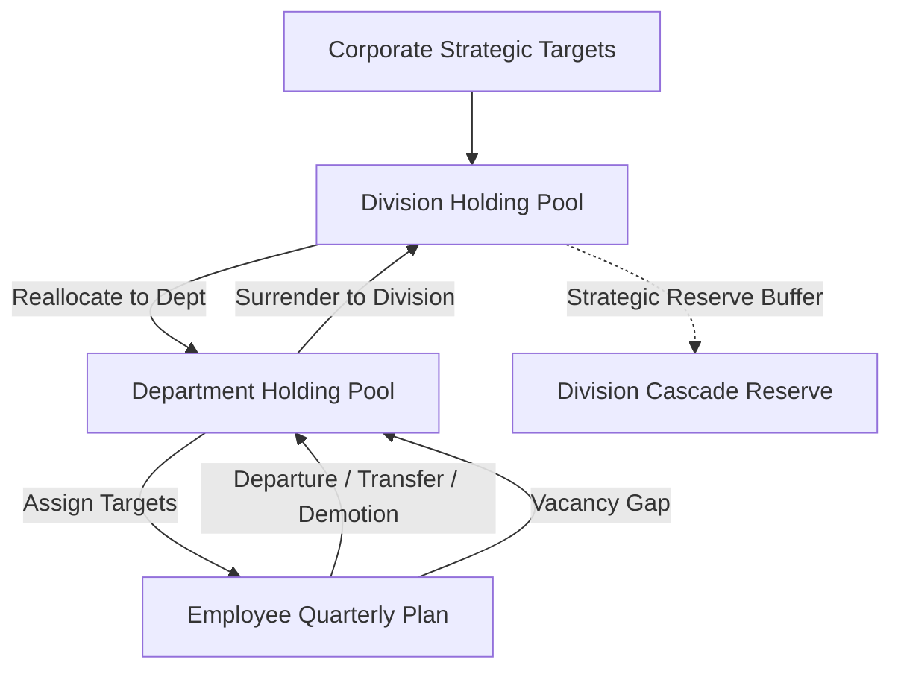

# 🚀 STRATEGIZE PROJECT MASTER HANDOFF DOCUMENT

> **Purpose:** This document provides an exhaustive, production-grade technical handoff of the entire **Strategize** enterprise platform. It captures the full architecture, database schemas, core subsystems, recent commits, uncommitted changes, active environments, key personas, and known issues so a new agent or developer can seamlessly resume work in a fresh conversation.

---

## 📌 CRITICAL USER CONSTRAINTS
> [!CAUTION]
> **STRICT USER RULE 1:** **DO NOT COMMIT TO GIT OR PUSH UNLESS THE USER EXPLICITLY INSTRUCTS YOU TO DO SO.**  
> *"N:B. don't commit anything unless I told you to do explictly."*  
> Keep all working changes in the working tree until the user reviews and authorizes a commit.
>
> **STRICT USER RULE 2:** **DO NOT MAKE ANY CHANGES TO THE DATABASE.**  
> *"N:B. don't make any change to the database."*  
> Never perform direct schema alterations, raw DB migrations, TRUNCATE, DROP, or destructive data updates directly on PostgreSQL. All logic must be handled safely at the application code level.

---

## 1. Executive Summary & System Overview

**Strategize** is a strategic performance management and KPI cascading execution system. It provides end-to-end organizational alignment from enterprise corporate pillars down to weekly staff execution:

1. **Strategic Planning & Period Management:** Multi-year strategic cycles broken down into annual and quarterly execution periods.
2. **Four-Tier Cascade Engine:**  
   `Corporate Pillars & Objectives` ➡️ `Division Objectives & KPIs` ➡️ `Department Objectives & KPIs` ➡️ `Personnel/Employee KPIs`.
3. **Enterprise Target Rebalancing & Holding Pools:**  
   A two-level holding pool architecture (**Division Holding Pool** and **Department Holding Pool**) with an immutable **Target Adjustment Ledger** (audit trail) that manages unallocated quotas, cascade reserve buffers, mid-period departures, role promotions/demotions, lateral transfers, and dynamic proration ratios.
4. **Logbook & Weekly Pacing:** Weekly task and milestone tracking with evidence verification.
5. **CEO Pacing & Direct-Report Executive Monitoring:** Real-time leadership tracking across division heads and direct reports.
6. **Granular Multi-Tier RBAC:** Strict organizational scoping (`SYSTEM`, `CORPORATE`, `DIVISION`, `DEPARTMENT`, `SELF`).

---

## 2. Tech Stack & Environment Architecture

### 2.1 Backend (`strategize_api`)
- **Framework:** NestJS 10 (TypeScript, Node.js v24+)
- **API Architecture:** GraphQL (Apollo Server 4 / NestJS GraphQL, Code-First schema generation)
- **ORM & Database:** TypeORM 0.3.x with PostgreSQL 15/16
- **Authentication & Security:** JWT (`@nestjs/jwt`, `passport-jwt`), bcrypt password hashing, `RolesGuard`, `GqlAuthGuard`
- **Audit Logging:** System-wide `ActivityLogService`
- **Port:** `3000` (Listening on `http://localhost:3000/graphql` and `http://localhost:3000/hello`)

### 2.2 Frontend (`strategize-web`)
- **Framework:** Next.js 14/15 (React 18/19, App Router with client/server components)
- **API Client:** Apollo Client 3 (`@apollo/client`) with normalized cache and in-memory persistence
- **State Management:** Zustand with `persist` and `immer` middleware (`authStore`, `orgUnitStore`, `strategicPeriodStore`, `uiStore`, `cacheStore`)
- **Styling & UI Components:** Tailwind CSS, Radix UI primitives, shadcn/ui component library, Lucide React icons
- **Feedback & Notifications:** Sonner toast engine
- **Port:** `3001` (Accessible at `http://localhost:3001`)

### 2.3 Database & Infrastructure
- **RDBMS:** PostgreSQL running locally on port `5432`
- **Database Name:** `strategize_restore`
- **Database Credentials:** User: `postgres`, Password: `2806`
- **Active Git Branch:** `sprint/core-fixes-and-refactor` (Both `strategize_api` and `strategize-web`)

---

## 3. Repository & Directory Structure

```
c:\Users\hp\Strategize\
├── HANDOFF.md                                # This master handoff document
├── strategize_api\                           # NestJS Backend API
│   ├── src\
│   │   ├── auth\                             # JWT strategy, auth resolvers, roles & guards, decorators
│   │   ├── division\                         # Division entity, resolver, service, DTOs
│   │   ├── department\                       # Department entity, resolver, service, DTOs
│   │   ├── employee\                         # Employee entity, resolver, service, DTOs
│   │   ├── kpi\                              # KPI entity, cascading mapping, KPI mode enum (DIRECT, AGGREGATE, HYBRID)
│   │   ├── kpi-quarter\                      # Quarterly plan, target calculations, quarterly results
│   │   ├── objective\                        # Strategic objectives, assignee hierarchy (CORPORATE, DIVISION, DEPT, PERSONNEL)
│   │   ├── strategic-period\                 # Annual/quarterly strategic period management
│   │   ├── target-rebalancing\               # 🌟 Holding Pools, Ledger, Departure Clearance, Transfers, Proration
│   │   │   ├── dto\                          # Holding pool DTOs, clearance inputs, transfer/reallocation inputs
│   │   │   ├── entities\                     # DivisionHoldingPool, DepartmentHoldingPool, TargetAdjustmentLedger, DepartureClearanceRequest
│   │   │   ├── enums\                        # TargetAdjustmentType, DepartureClearanceStatus
│   │   │   ├── target-rebalancing.resolver.ts
│   │   │   └── target-rebalancing.service.ts
│   │   ├── logbook-entry\                    # Weekly staff task entries, milestone outcomes, status updates
│   │   ├── logbook-evidence-approval\        # Manager approval workflow for logbook deliverables
│   │   ├── activity-log\                     # Audit trail for user actions & mutations
│   │   ├── org-structure-sync\               # Node synchronization for graph/tree org visualization
│   │   └── main.ts                           # Server bootstrapper & global interceptors
│   ├── .env                                  # DB_HOST, DB_PORT, DB_NAME, DB_USER, DB_PASSWORD, JWT_SECRET
│   └── package.json
└── strategize-web\                           # Next.js Frontend Web Application
    ├── src\
    │   ├── app\
    │   │   ├── dashboard\
    │   │   │   ├── divisions\                # 🌟 Division management & list table
    │   │   │   │   └── [divisionId]\         # 🌟 Division details, Department breakdown, Division Holding Pool tab
    │   │   │   ├── departments\              # Department list
    │   │   │   │   └── [departmentId]\       # 🌟 Department dashboard, KPIs, Holding Pool & Staff Target Rebalancer
    │   │   │   ├── employees\                # Staff directory & employee profile management
    │   │   │   ├── objectives\               # Objective trees & cascade hierarchy
    │   │   │   ├── approvals\                # Submissions, departure clearance, and logbook reviews
    │   │   │   └── reports\                  # CEO leadership reports, pacing, scorecard snapshots
    │   ├── components\
    │   │   ├── divisions\                    # DivisionTable, EditDivisionDialog, DeleteDivisionDialog, DivisionHoldingPoolManager
    │   │   ├── departments\                  # DepartmentHoldingPoolManager, EditDepartmentDialog, AddDepartmentDialog
    │   │   ├── ui\                           # shadcn/ui components (button, dialog, card, table, select, badge)
    │   │   └── auth\                         # LoginForm, route auth guards
    │   ├── hooks\
    │   │   ├── permissions\                  # usePermissions hook
    │   │   ├── divisions\                    # useDivisionMutations
    │   │   └── departments\                  # useDepartmentMutations
    │   ├── lib\
    │   │   ├── graphql\                      # GraphQL query and mutation definitions
    │   │   └── rbac\                         # guards.ts, roles.ts, scopes.ts, permissions.ts
    │   ├── stores\                           # authStore.ts, strategicPeriodStore.ts, orgUnitStore.ts
    │   └── types\graphql.ts                  # Generated TypeScript interfaces from GraphQL schema
    ├── .env.local
    └── package.json
```

---

## 4. Database Schema & Architecture

The database is PostgreSQL (`strategize_restore`). The most critical tables and relationships are:

### 4.1 Organizational Hierarchy
- **`Organization`**: Multi-tenant top-level tenant (`organizationId`, `name`).
- **`Division`**: Corporate divisions (`divisionId`, `name`, `headUserId` -> `Employee.employeeId`, `organizationId`).
- **`Department`**: Operational departments (`departmentId`, `name`, `divisionId` -> `Division.divisionId`, `headUserId` -> `Employee.employeeId`).
- **`Employee`**: Personnel (`employeeId`, `fullName`, `email`, `role`, `status`, `managerId`, `startDate`).

### 4.2 Role & Access Control
- **`Role`**: Roles defined in the system (`roleId`, `code`, `name`):
  - `SUPER_ADMIN`: Full system access across all tenants.
  - `ADMIN`: Corporate administration.
  - `HR`: Human resources and personnel life-cycle.
  - `DIRECTOR`: Division-level director (Division scope).
  - `MANAGER`: Department manager (Department scope).
  - `COORDINATOR`: Team / Department coordination.
  - `NORMAL`: Regular staff / Personnel.
  - `CEO`: Executive observer with read-only org monitoring and direct-report logbook review.
- **`UserRoleAssignment`**: User to Role mapping.

### 4.3 Strategic Cascade & KPIs
- **`StrategicPeriod`**: Strategic cycles (e.g. 2026 Annual, Q1, Q2, Q3, Q4).
- **`Objective`**: Strategic objectives (`objectiveId`, `title`, `assigneeType`: `CORPORATE` | `DIVISION` | `DEPARTMENT` | `PERSONNEL`, `assigneeId`, `parentId`).
- **`KPI`**: Key performance indicators (`kpiId`, `name`, `kpiMode`: `DIRECT` | `AGGREGATE` | `HYBRID`, `assigneeType`, `assigneeId`, `target`, `unit`):
  - `DIRECT`: Metric owned and executed solely by the unit head (e.g. Manager Training Hours, Director Leadership Index). Excluded from staff holding pool.
  - `AGGREGATE`: Rolled-up metric cascaded down to subordinate staff. Included in holding pool.
  - `HYBRID`: Shared target partially owned by manager and partially distributed to subordinates. Included in holding pool.
- **`KpiQuarterPlan`**: Target plan per quarter (`planId`, `kpiId`, `quarterNumber`, `baseTarget`, `adjustedTarget`, `assignedTarget`).
- **`KpiQuarterResult`**: Actual performance results per quarter.

### 4.4 Target Rebalancing & Holding Pools
- **`DivisionHoldingPool`**:
  - `poolId`, `divisionId`, `kpiId`, `annualStrategicPeriodId`, `quarterNumber`, `balance`, `totalHarvested`, `totalDistributed`.
  - Holds division-level strategic reserve buffers and unallocated quotas before or during department cascade.
- **`DepartmentHoldingPool`**:
  - `poolId`, `departmentId`, `kpiId`, `annualStrategicPeriodId`, `quarterNumber`, `balance`, `totalHarvested`, `totalDistributed`.
  - Holds department-level unassigned targets, departed employee quota reclamation, and vacancy gaps.
- **`TargetAdjustmentLedger`**:
  - Immutable double-entry audit ledger for all target movements:
  - `ledgerId`, `organizationId`, `divisionId`, `departmentId`, `kpiId`, `quarterNumber`, `transactionType`, `amount`, `sourceEmployeeId`, `targetEmployeeId`, `reason`, `approvedById`, `createdAt`.
  - **Transaction Types:** `DEPARTURE_SWEEP`, `INTERNAL_TRANSFER`, `ROLE_PROMOTION`, `ROLE_DEMOTION`, `POOL_ALLOCATION`, `MANUAL_REBALANCE`, `CASCADE_RESERVE_IN`, `DEPT_TO_DIVISION_SURRENDER`, `DIVISION_TO_DEPT_REALLOCATION`.
- **`DepartureClearanceRequest`**:
  - Workflow for employee exit / departures (`requestId`, `employeeId`, `departmentId`, `status`: `PENDING` | `APPROVED` | `REJECTED`, `effectiveDate`, `unachievedTargetSwept`).

---

## 5. Core Business Subsystems & Workflows

### 5.1 The Holding Pool & Rebalancing Lifecycle

1. **Division Strategic Reserve:** A Division Director can withhold a portion of cascaded targets as a safety buffer in the Division Holding Pool (`setDivisionCascadeReserve`).
2. **Inter-Department Rebalance:** If Department A has surplus/unachievable quota, it surrenders it up to the Division Pool (`surrenderDepartmentPoolToDivision`), and the Director reallocates it down to Department B (`reallocateDivisionPoolToDepartment`).
3. **Department Holding Pool Manager:** Department managers assign targets from the pool to active employees.
4. **Proration & Vacancy Gap:**
   - When assigning a target to a staff member who joins mid-quarter (or has a custom start date), the system calculates the exact proration factor:  
     $$\text{Proration Factor} = \frac{\text{Days Active in Quarter}}{\text{Total Quarter Days}}$$
   - **Effective Target to Employee:** $\text{Base Target} \times \text{Proration Factor}$
   - **Vacancy Gap:** The unassigned remainder ($\text{Base Target} - \text{Effective Target}$) stays in the Department Holding Pool for reallocation to a backfill candidate or other staff.
   - The Assign modal renders a live breakdown showing the base amount, proration factor, effective target, and vacancy gap difference.

### 5.2 Scoping & Multi-Tier RBAC
- **Super Admin / Admin:** Corporate-wide view and mutation authority across all divisions, departments, and employees.
- **Director:** Scoped to their managed division (`scope.managedDivisionIds`).
  - Can view all divisions in read-only mode.
  - Can ONLY edit, add departments to, or rebalance holding pools for **their own division**.
  - Forbidden from deleting divisions (deletion is Admin-only).
- **Manager:** Scoped to their managed department (`scope.managedDepartmentIds`).
  - Can manage departmental KPIs, logbooks, staff assignments, and department holding pools.

### 5.3 HR Approval & Tri-Party Notification Workflow for Lateral Transfers
- **Zero-DB-Schema Architecture:** Stores transfer requests directly within the existing `departure_clearance_requests` table with an encoded reason prefix: `[INTERNAL_TRANSFER:toDepartmentId=<uuid>] <reason>`. Virtual entity getters (`requestType`, `destinationDepartmentId`, and `destinationDepartment`) dynamically parse this without requiring any PostgreSQL migrations or DDL changes, strictly complying with User Rule 2.
- **Workflow Lifecycle:**
  1. **Manager Submission:** A department manager requests an employee transfer via `DepartmentHoldingPoolManager.tsx` ("Request Employee Transfer" modal), selecting the employee, destination department, effective date, and reason.
  2. **HR Notification & Action (`APPROVAL_REQUEST`):** The clearance request is created in `PENDING` status. The system resolves all HR officers and Admins and delivers an in-app notification: *"Transfer Request: [Employee] from [Source Dept] to [Destination Dept] needs your review."* HR can review and click Approve or Reject either directly from the notification bell dropdown or from the department holding pool manager.
  3. **HR Approval Execution (`approveDepartureClearance`):**
     - Atomically executes `processInternalTransfer` within the database transaction.
     - Sweeps unworked quotas from active and future quarters into the source department's holding pool.
     - Logs `INTERNAL_TRANSFER` and `DEPARTURE_SWEEP` audit records in `TargetAdjustmentLedger` with valid KPI IDs.
     - Atomically migrates `DepartmentEmployee` relation (deletes from source department, inserts into destination department).
     - **Employee Status Safety:** Keeps employee status `ACTIVE` (unlike standard departures which set `DISABLED`) so the destination department can immediately assign holding pool quotas.
     - Sets request status to `APPROVED`.
  4. **Tri-Party Notification Broadcast:**
     - **To Receiver Department Manager (`APPROVAL_RESULT` / Action Required):** *"New Team Member: [Employee] has been transferred to [Destination Dept] effective [Date]. Please review holding pool targets and assign quarterly quotas."*
     - **To Sender Department Manager (`APPROVAL_RESULT`):** *"Transfer Approved: [Employee] transferred to [Destination Dept]. Unworked target balance swept to holding pool."*
     - **To Transferred Employee (`APPROVAL_RESULT` / Informational):** *"Department Transfer Approved: You have been transferred from [Source Dept] to [Destination Dept] effective [Date]."*
  5. **HR Rejection Execution (`rejectDepartureClearance`):**
     - Sets clearance request status to `REJECTED` with the rejection reason.
     - Notifies Sender Manager: *"Transfer Request Rejected: Request to transfer [Employee] to [Destination Dept] was rejected. Reason: [Reason]."*
     - No quotas are swept and the employee remains in the source department.

---

## 6. Recent Work Done & Uncommitted Working Tree State

### 6.1 Recent Commits (Local, on `sprint/core-fixes-and-refactor`)
- `caaf37c` (`strategize-web`): `feat(holding-pool): integrate employee transfer refetch and enforce row-level division director scoping`
- `35c4a7e` (`strategize_api`): `feat(target-rebalancing): support employee transfer with department transition and enforce director scoping`
- `580e1ea`: `feat(holding-pool): display live prorated target breakdown and vacancy gap in assign modal`
- `b400711`: `fix(holding-pool): strictly enforce pool balance boundaries, validate percentage targets <= 100%, and prevent over-allocation`
- `3e61726`: `feat(holding-pool): format assign buttons and pool targets with explicit metric units (e.g. ETB, %, Units, Deals)`
- `06a0b8c`: `fix(holding-pool): strictly filter out departed employees from target assignment, transfer, and promotion dropdowns`
- `851197f`: `fix(departure): exclude DISABLED/DELETED employees from assignment dropdowns and add status to dept query`
- `6562690`: `fix(holding-pool): include KPIs linked via department strategic objectives`

### 6.2 Working Tree State (Uncommitted Changes)
In strict compliance with **User Rule 1**, the following changes are maintained in the working tree and will NOT be committed or pushed until the user explicitly instructs to do so:

1. **`strategize_api`:**
   - `src/kpi-quarter/kpi-quarter-report-access.service.ts`: Included departed (`DISABLED`) employees alongside `ACTIVE` in `uniqueEmployees` and report queries (excluding `DELETED`).
   - `src/kpi-quarter/dto/kpi-quarter-report.object.ts` & `src/kpi-quarter/kpi-quarter-report.service.ts`: Exposed `employeeStatus` field on `KpiQuarterReportRow` and mapped it through `resolvePlacement`.
   - `src/unified-performance/unified-performance.service.ts`: Default inclusion of departed staff (`status != DELETED`) in scoped employee lookups.
   - `src/target-rebalancing/entities/departure-clearance-request.entity.ts`: Added zero-DB-schema virtual getters (`requestType`, `destinationDepartmentId`, and `destinationDepartment`) to decode lateral transfer payloads stored in the existing `reason` column without database mutations.
   - `src/target-rebalancing/target-rebalancing.service.ts`:
     - Updated `requestDepartureClearance` to validate and route internal transfer requests to HR in `PENDING` status with an `APPROVAL_REQUEST` notification.
     - Updated `approveDepartureClearance` to execute lateral transfers via `processInternalTransfer`, keep employee status `ACTIVE`, and broadcast tri-party notifications (Receiver Manager: `New Team Member`, Sender Manager: `Transfer Approved`, Transferred Employee: `Department Transfer Approved`).
     - Updated `rejectDepartureClearance` to reject transfer requests and notify the sender manager with the rejection reason.
     - Fixed `kpiId` foreign key assignment in `TargetAdjustmentLedger` entries for transfers.
     - Fixed `createdById` not-null constraint violation in `distributeHoldingPoolQuota`, `processRoleTransition`, and `reallocateDivisionPoolToDepartment` by propagating approver/parent creator IDs.
   - `src/target-rebalancing/target-rebalancing.service.spec.ts`: 21 comprehensive unit tests covering all transfer, approval, rejection, and notification paths (all passing).

2. **`strategize-web`:**
   - `src/components/reports/QuarterlyPerformanceReport.tsx` & `src/components/reports/UnifiedPerformanceReport.tsx`: Displayed clear amber `Departed` and `Departed (Read-Only)` badges next to departed staff.
   - `src/lib/graphql/queries/quarterly-performance.ts`, `unified-performance.ts`, and `src/types/graphql.ts`: Added `employeeStatus` field.
   - `src/lib/graphql/queries/target-rebalancing.ts`: Added `requestType`, `destinationDepartmentId`, and `destinationDepartment` to `GET_DEPARTURE_CLEARANCE_REQUESTS`.
   - `src/components/dashboard/NotificationDropdown.tsx`: Supported inline HR review, approval, and rejection of transfer requests.
   - `src/components/departments/DepartmentHoldingPoolManager.tsx`:
     - Updated `handleInternalTransfer` to submit transfer requests for formal HR clearance.
     - Updated modal copy to "Request Employee Transfer" / "Submit Transfer for HR Approval".
     - Updated "Clearances & Transfers" tab table and alert banners to dynamically display transfer badges, destination department names, clean reasons, and role-appropriate actions.
     - Integrated instant department roster refetching via `onEmployeeTransferred` callback upon HR approval.

3. **Verification Status:**
   - API Unit Tests: `npm test -- src/target-rebalancing` passed (21/21 tests).
   - API Build: `npm run build` completed with code 0.
   - Web TypeScript Check: `pnpm exec tsc --noEmit` completed with code 0.

---

## 7. Active Processes & Environment Credentials

| Service | Port | Process / Status | Notes |
|---|---|---|---|
| **PostgreSQL** | `5432` | Running (Service `strategize_restore`) | Password: `2806` |
| **NestJS API** | `3000` | Running (`nest start --watch`, PID 16880) | `http://127.0.0.1:3000/graphql` |
| **Next.js Web** | `3001` | Running (`next dev`, PID 14572) | `http://127.0.0.1:3001` |

### Key Test Personas (Password for all: `123456`)
- **Super Administrator:** `admin@strategize.com` (Global corporate access)
- **Amare Jimma:** `amare@icapitalafrica.org`  
  - *Role:* `DIRECTOR`  
  - *Employee ID:* `9862dfb0-9c38-4d70-aad3-ac646cf7a977`  
  - *Division:* `i-Capital Institute` (`3d2600dd-4f27-43df-a453-11bafe195670`)
- **Mekuriya Worku:** `mekuriya@icapitalafrica.org`  
  - *Role:* `DIRECTOR`  
  - *Division:* `Digital and AI Solution` (`1f6546f0-4e3e-405c-b283-73f952a08186`)
- **Dawit Solomon:** `dawit@icapitalafrica.org`  
  - *Role:* `MANAGER`  
  - *Department:* `Software Development and Innovation` (`1250a765-7824-4b24-a11d-5bf8d70cd720`)

---

## 8. Known Bugs, Edge Cases & Immediate Next Steps

1. **Pre-existing Unit Test Discrepancy:**
   - In `strategize_api/src/org-chart/org-chart.service.pbt.spec.ts`, lines 533 and 748 fail with `TS2554: Expected 6 arguments, but got 4.` This is a legacy mock signature mismatch in an existing test file. Core application code compiles with 0 errors.
2. **Division Holding Pool Query Scoping (Minor Edge Case):**
   - The query `divisionHoldingPool` is currently readable by any authenticated user for transparency. If strict division data isolation is desired, add `@Roles` or a director division check in `getDivisionHoldingPool`.
3. **Pending Review from User:**
   - The user requested:
     1. Display prorated amount on the assign target modal (`DepartmentHoldingPoolManager.tsx`) - **DONE**.
     2. Fix KPI count (25 parent KPIs under Dawit Solomon) - **DONE**.
     3. Filter out DIRECT KPIs from holding pool query so only AGGREGATED/HYBRID appear - **DONE**.
     4. Enforce division-level scoping for Amare Jimma on `http://localhost:3001/dashboard/divisions` so he cannot edit or manage other directors' divisions (DAS, Investment Partner) - **DONE**.
     5. Transfer Employee Scenario & Testing - **DONE**:
        - Enhanced `processInternalTransfer` in `TargetRebalancingService` to atomically update the `DepartmentEmployee` relation (removing employee from source department and adding to destination department), with strict validation guards (`fromDepartmentId !== toDepartmentId`, source/destination department existence, and date validation).
        - Added comprehensive unit and integration test suite in `target-rebalancing.service.spec.ts` covering validation edge cases, quota sweeping, membership migration, audit ledger records, and downstream target assignment in destination department (18 tests passing).
        - Integrated `onEmployeeTransferred` callback in `DepartmentHoldingPoolManager.tsx` and wired `refetchDepartment` in `departments/[departmentId]/page.tsx` so member counts and employee lists update immediately upon transfer.
     6. Departed Employee Historical Visibility (Read-Only) - **DONE**:
        - Updated `KpiQuarterReportAccessService`: Included `EmployeeStatus.DISABLED` (departed staff) alongside `ACTIVE` in `uniqueEmployees` and organization queries, while strictly excluding `DELETED` records.
        - Exposed `employeeStatus` on `KpiQuarterReportRow` and mapped it through `KpiQuarterReportService.resolvePlacement`.
        - Updated `UnifiedPerformanceService`: In `getScopedEmployees`, `getEmployeesForScope`, and `getEmployeesByIds`, included departed staff (`status != DELETED`) by default when `includeInactive` is not set to `false`.
        - Updated `QuarterlyPerformanceReport.tsx` and `UnifiedPerformanceReport.tsx`: Displayed a clear `Departed` / `Departed (Read-Only)` badge next to departed staff in report tables, individual rankings, top performers, and milestone detail dialogs.
     7. HR Approval & Tri-Party Notification Workflow for Lateral Transfers - **DONE**:
        - Zero-DB-schema architectural pattern: Lateral transfer requests are routed via `requestDepartureClearance` using encoded reason tokens (`[INTERNAL_TRANSFER:toDepartmentId=...]`). Virtual getters on the entity dynamically expose `requestType`, `destinationDepartmentId`, and `destinationDepartment` with 0 database schema changes.
        - HR Approval Engine: When HR approves, `approveDepartureClearance` invokes `processInternalTransfer`, keeps employee status `ACTIVE`, moves the `DepartmentEmployee` relation atomically, sweeps unworked target quota to the source department holding pool, and writes `INTERNAL_TRANSFER` & `DEPARTURE_SWEEP` ledger records.
        - Tri-Party Notifications:
          - **To HR (`APPROVAL_REQUEST`):** Notification of pending transfer requiring review.
          - **To Receiver Department Manager (`APPROVAL_RESULT`):** Action-required notice to assign holding pool quotas to the new arrival.
          - **To Sender Department Manager (`APPROVAL_RESULT`):** Confirmation of approval and quota sweep, or notification of rejection with reason.
          - **To Transferred Employee (`APPROVAL_RESULT`):** Informational notice that transfer was approved.
        - UI & Frontend: Updated `DepartmentHoldingPoolManager.tsx` with dynamic "Clearances & Transfers" tab, pending alerts with inline actions, transfer submission modal, and immediate roster refetch via `onEmployeeTransferred`.
     8. Departed & Transferred Employee Experience, Write Guards & Department-Grouped KPI View - **DONE**:
        - **API & Security Guards:**
          - Updated `jwt.strategy.ts` to include `status: emp.status` in the authenticated user context.
          - Updated `gql-auth.guard.ts` to intercept all GraphQL mutations. When `user.status === EmployeeStatus.DISABLED`, it throws `ForbiddenException('Account is disabled / offboarded. Write operations are prohibited in read-only archive mode.')`. Added `gql-auth.guard.spec.ts` unit test suite (4/4 passed).
        - **GraphQL Context & Queries:**
          - Updated `GET_ME` and `LOGIN_EMPLOYEE` queries to eagerly include `departments { departmentId name code }`, making the active department reliably accessible across frontend components.
          - Updated `GET_DEPARTURE_CLEARANCE_REQUESTS` to load source and destination department details.
          - Updated `GET_KPI_ASSIGNMENTS_EMPLOYEE` to include `kpi { parent { kpiId name assigneeType assigneeId } }`.
        - **Frontend UI & Banners:**
          - Created `EmployeeLifecycleBanner.tsx`: Renders clear amber offboarded notice for departed employees (`status === DISABLED`) and transfer banner for transferred employees (`status === ACTIVE` with clearance record). Integrated into `/dashboard` and `/dashboard/kpi-scorecard`.
          - Updated `Topbar.tsx`: Added active department badge (`Relationship and Growth`) and amber `Offboarded (Read-Only)` pill.
          - Updated `/dashboard/logbook/page.tsx`, `LogbookTableRow.tsx`, `LogbookTableCard.tsx`: Disabled "Add entry", "Edit", and "Submit" actions for offboarded accounts with explanatory alerts.
          - Updated `/dashboard/checkin/page.tsx` & `/dashboard/kpis/page.tsx`: Added read-only alerts and disabled "New KPI", "Edit", and "Delete" for offboarded accounts.
        - **Department-Grouped KPI View:**
          - In `IndividualScorecard.tsx`: Grouped KPIs by department context with interactive filter pills (`All KPIs`, `Active Department`, `Previous Department - Archived`).
          - Displayed department tags on every KPI row (`[Relationship & Growth (Active)]` vs `[Software Development (Archived Q1)]`).
          - In `QuarterPerformanceCell.tsx`: Displayed `Rebalanced to Pool` for zeroed Q2-Q4 targets with tooltips clarifying quota redistribution while honoring historical quarters.
      9. Promotion / Role Transition Lifecycle & Frontend Workflow - **DONE**:
         - **Backend Adjustments:**
           - Added optional `newRole?: EmployeeRole` to `ProcessRoleTransitionInput` so promotions can upgrade the system access role (e.g., from `NORMAL` to `COORDINATOR` or `MANAGER`).
           - Enhanced `processRoleTransition` in `TargetRebalancingService` to atomically:
             1. Update `employee.title` and `employee.role` (if `newRole` is provided).
             2. Zero out unworked targets for quarters >= `effectiveQuarter` on retired old KPIs, sweeping quota back to holding pool and updating `KpiAssignmentEmployee.targetValue` to match remaining delivered quarters.
             3. Allocate new role individual KPIs with quarter plans for active quarters >= `effectiveQuarter`, drawing quota from holding pool.
             4. Dispatch an automated congratulatory notification (`SYSTEM_ALERT`) to the employee announcing the new title and role transition effective quarter.
           - Added test coverage in `target-rebalancing.service.spec.ts` (all 21 unit tests passing) and confirmed `nest build` succeeds with code 0.
         - **Frontend Promotion Dialog & Integration:**
           - Built `PromoteEmployeeDialog.tsx` with comprehensive real-time validation:
             1. **New Position Configuration:** New title, system role dropdown, effective quarter selector, promotion reason.
             2. **Old KPI Retirement Selection:** Multi-select checklist allowing selective or total retirement of prior role KPIs from the effective quarter onwards, preserving historical quarters.
             3. **New Role KPI Allocation Builder:** Cascades from department holding pool parent KPIs, configuring quarterly targets and local weights.
             4. **Real-time Holding Pool Quota Validation:** Dynamically verifies that requested quarterly targets do not exceed available holding pool balance, highlighting violations and blocking submission.
             5. **Real-time Weight Balance Preview:** Live calculation tracking retained old KPI weights + new role KPI weights, alerting if total active weight deviates from 100%.
           - Integrated `PromoteEmployeeDialog` into `EmployeeActionsMenu.tsx` (on `/dashboard/employees` under the table action menu with an `Award` icon) for all active staff.
           - Integrated `PromoteEmployeeDialog` into `DepartmentHoldingPoolManager.tsx` under the "Change Role / Promotion" button.
         - **Logbook Write Protection for Retired Role KPIs:**
           - In `LogbookEntryDialog.tsx`: Detected KPIs with zeroed quarter plans (`effectiveTarget === 0 && originalTarget === 0`).
           - Rendered an informative amber warning banner when a retired KPI is selected: *"Retired Role KPI: Target for Quarter [X] was rebalanced to the department holding pool upon role promotion/transfer. New entries cannot be logged against this retired KPI."*
           - Blocked submission and disabled the save button when a retired KPI is chosen.
      10. Targets Given Out Quota Aggregation Fix in Relationship & Growth - **DONE**:
          - **Root Cause:** In `DepartmentHoldingPoolManager.tsx`, the `isCurrency` helper strictly checked `unitType === 'CURRENCY' || unit.includes('ETB'|'USD')`. The KPI `RG-Supported Qualified Pipeline Value` has an annual target of 733.4M ETB and had 6,111,875 distributed to Egnuma in Q2, but its database `unitType` was `'NUMBER'` and `measurementUnit` was `'number'`. Consequently, `isCurrency` evaluated to `false`, causing the KPI's distributed quota to be excluded from `financialDistributed` and rendering **"Targets Given Out" as 0**.
          - **Fix:** Enhanced `isCurrency` in `DepartmentHoldingPoolManager.tsx` to recognize financial/value KPIs by name (`PIPELINE VALUE`, `REVENUE`, `VALUE`) and high-value annual targets (>= 1,000,000).
          - Added a dedicated "Distributed to Staff" line item under each quarter card in the Quarters Grid whenever `q.totalDistributed > 0`.
          - Now "Targets Given Out" accurately displays **`ETB 6,111,875.00`** in Relationship and Growth.
   - These changes are currently uncommitted in the working tree awaiting explicit approval to commit.

---

## 9. How to Resume in a New Chat Session

When starting a new session, follow these steps:
1. Confirm the active branches:
   ```powershell
   git -C c:\Users\hp\Strategize\strategize-web branch --show-current
   git -C c:\Users\hp\Strategize\strategize_api branch --show-current
   ```
2. Verify that the API and Web processes are active:
   ```powershell
   curl.exe http://127.0.0.1:3000/hello
   curl.exe -I http://127.0.0.1:3001
   ```
3. Read `c:\Users\hp\Strategize\HANDOFF.md` (this file) to restore context.
4. Remember the primary rule: **NEVER COMMIT OR PUSH WITHOUT EXPLICIT USER INSTRUCTION.**
